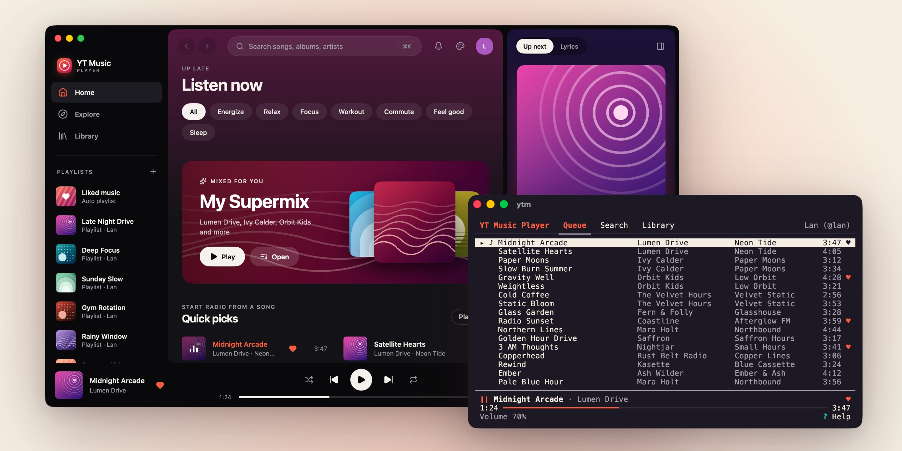

# YT Music Player

<picture>
  <source media="(prefers-color-scheme: dark)" srcset="docs/images/readme-hero-dark.jpg">
  
</picture>

A lightweight YouTube Music desktop player for macOS, Linux and Windows. Native, GPU-drawn UI in Go with [MyGo](https://mygo.egoist.dev): no webview, no Electron, about 60 MB of memory, no frames drawn when idle.

- Home, Explore, search, albums, playlists, your library and liked songs
- Queue, shuffle, repeat, media keys
- Plays on in the background when the window closes; `ytm` plays and controls it from a terminal
- Themes, or [your own](docs/theme.md)

> Not affiliated with YouTube or Google.

## Install

| System | How |
|---|---|
| macOS 12+ | `brew install --cask xlanstar/tap/yt-music-player`, or the `.dmg` |
| Linux (amd64, arm64) | `curl -fsSL https://github.com/xlanstar/yt-music-player/releases/latest/download/install.sh \| sh`, or the `.deb` |
| Windows 10+ (x64, Arm) | the `-setup.exe` |

Downloads are on [Releases](../../releases). The app updates itself (the `.deb` updates through `apt`).

- **Linux** needs GTK 3, and PulseAudio, PipeWire or ALSA for sound; not WebKitGTK.
- **Windows** builds aren't code-signed: in SmartScreen, choose *More info → Run anyway*. No media keys yet.

## Sign in

In your browser's developer tools, copy the `Cookie` header of any `music.youtube.com` request and paste it into the app's sign-in sheet. It's kept in the macOS Keychain, or a private file in your config directory elsewhere.

`ytm login` signs in from a terminal instead: paste the header, or pipe it (`pbpaste | ytm login`). After upgrading from 0.1 on macOS, sign in once more: the background player can't read the app's Keychain item.

If [yt-dlp](https://github.com/yt-dlp/yt-dlp) is installed (with Homebrew, pipx, or on your `PATH`), it plays songs the app can't play on its own, such as those made for kids. Installed other than with Homebrew, it also needs [Deno](https://deno.com).

## Background player and `ytm`

Songs play in a small background player, `ytmd`, which the app starts and which plays on when the window closes or the app quits; paused, it wakes nothing. *Quit and Stop Playback* in the app menu, or `ytm daemon stop`, stops it. *Start background player at login* in Settings (or `ytm autostart on`) has it ready for the media keys from login; deleting the app turns that off at the next login (on Windows, turn it off before uninstalling).

`ytm` is the player in a terminal, with covers where the terminal shows images (Kitty, Ghostty, iTerm2, WezTerm, Sixel, or colored blocks; `YTM_IMAGES=off` turns them off), and a command line for scripts: `ytm status [--json]`, `ytm play|pause|next|prev`, `ytm volume 50`, `ytm help` for the rest. Homebrew and the Linux packages put it on your `PATH`; on Windows, turn on *Use ytm in a terminal* in Settings. The macOS app has it at `/Applications/YT Music Player.app/Contents/Resources/ytm`. How it works: [docs/daemon.md](docs/daemon.md).

## Build from source

Requires Go 1.27+ and jq.

```sh
scripts/build.sh    # build for this system into build/
scripts/install.sh  # macOS: build and install with Homebrew, as the cask does
```

## Development

```sh
go run ./cmd/ytmd                                          # the background player; Ctrl+C stops it
go run ./cmd/desktop                                       # the app, in another terminal
go run ./cmd/ytm                                           # the terminal player, in another terminal
go run -tags placeholder ./cmd/ytmd                        # offline fake catalog, no audio (both with the tag)
YT_SOURCE_DELAY=800ms go run -tags placeholder ./cmd/ytmd  # with loading states
YT_LOG=debug go run ./cmd/ytmd                             # why fetches, sign-ins or streams failed; ytm logs shows where
prek run --all-files                                       # every check; must pass
```

Tools are pinned in `.tool-versions`; `prek install` adds the checks as a pre-commit hook. Project rules and layout: [AGENTS.md](AGENTS.md). Releasing: [docs/release.md](docs/release.md). Performance: [docs/performance.md](docs/performance.md).

## License

[MIT](LICENSE)
