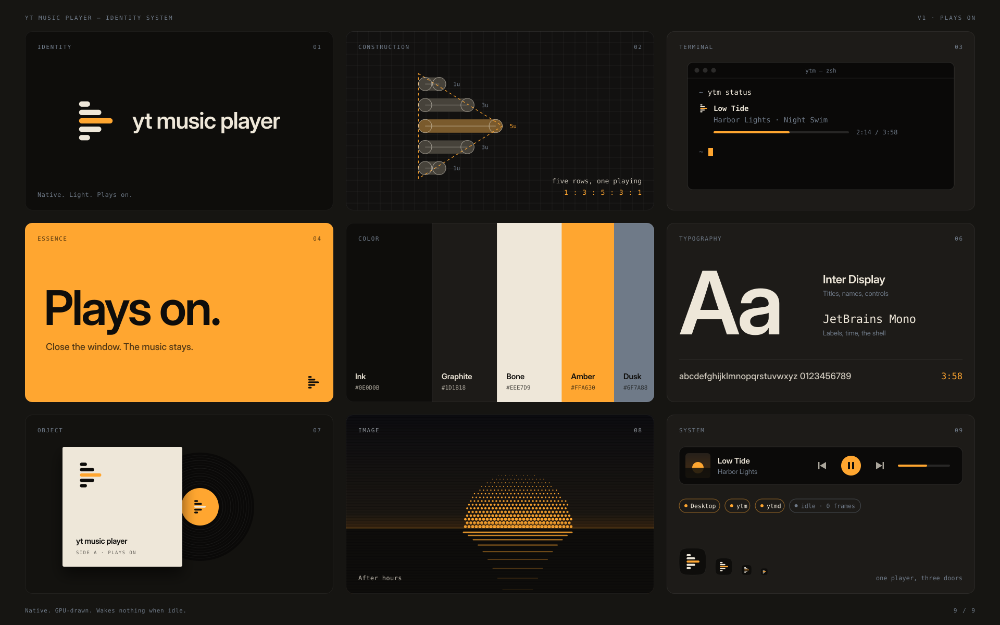

# Brand

The player's identity: the idea, the mark, the wordmark, color, type and where each is drawn. The board below holds it on one page; `scripts/brandkit.py` renders it and the mark into `assets/brand/`.

## Strategy

| | |
|---|---|
| Category | A desktop music player, with a terminal player and a background player behind both |
| Audience | People who keep music on all day and want it to cost nothing: developers, people who live in a terminal, people who close windows |
| Promise | The music plays on when the window closes, and an idle player wakes nothing |
| Personality | Quiet, exact, warm, after hours |
| Visual mode | Dark developer meets cultural: near-black panels, monospace labels, one warm accent, halftone and scanline images |
| Avoid | YouTube's red, its play button and its logo (the player is not affiliated with YouTube); glossy gradients; neon; more than one accent |

The board answers five questions:

1. **What it represents:** one player, three doors: the Desktop, `ytm` and `ytmd` behind them.
2. **The core metaphor:** the queue. What plays is one line in a list, which the terminal shows literally.
3. **How the mark says it:** the queue's rows, read together, are a play button; the row playing is lit.
4. **How it scales:** the rows are lines of text in a terminal, a progress bar in the app, a horizon's reflection in images.
5. **Why it is ownable:** a play triangle made of nothing but list rows, in amber, belongs to no one else.

## Essence

**Plays on.** Close the window; the music stays.

Taglines stay this short and say something the player does. Others in use: *Native. Light. Plays on.* and *Wakes nothing when idle.*

## Mark

Five queue rows, left-aligned, whose lengths (1 : 3 : 5 : 3 : 1) draw a play triangle pointing right. The middle row, the song playing, is the accent; the others are the foreground.

Construction, in a 120-unit box:

- Rows 14 units thick with round caps, 22 apart, centered on y = 60.
- Each row starts at x = 23; row *k* (−2 to 2) ends at 23 + 74 · (1 − |k| / 2.5).
- The caps' outer edges touch a triangle whose apex is the middle row's right cap.

Use:

- Clear space: one row step (22 units at 120) on every side.
- Smallest: 16 px in the app icon, 18 px alone, where the five rows still separate.
- On dark grounds Bone rows and an Amber middle row (`mark.svg`); on light grounds Ink rows (`mark-light.svg`). In one color, every row in that color.
- Never: rotate or mirror it, change the row count or ratios, light another row, outline it, or set it in a play-button frame.

The mark is drawn in four places, which change together: `scripts/brandkit.py` (`mark`), `assets/icon/icon.svg`, the sidebar's `paintMark` (`cmd/desktop/sidebar.go`, rows in the theme's Text and Accent) and `assets/brand/*.svg`, which the script writes.

## Wordmark

**YT Music Player**, in title case, Inter Display SemiBold, tracked tight (−0.02 to −0.03 em). The lockup is the mark, then the wordmark, about a third of the mark's width apart and centered on it.

The name reads the same everywhere it is shown: the lockup, the sidebar, `ytm`, sentences, menus, the app bundle, Now Playing, MPRIS and the Keychain.

## Color

| Name | Hex | Role |
|---|---|---|
| Ink | `#0E0D0B` | Grounds, the app's Base; text on Amber |
| Graphite | `#1D1B18` | Raised panels, the app's Raised |
| Bone | `#EEE7D9` | Text and the mark's rows on dark; light grounds |
| Amber | `#FFA630` | The one accent: what plays, primary actions, the mark's middle row |
| Dusk | `#6F7A88` | Labels and idle states; never an accent |

- Amber carries the whole system: one Amber thing per view, the song or the action.
- On Amber, text is Ink (9.9 : 1); white reads under 2 : 1.
- On Bone, Amber is a fill or the mark's row, never text (1.7 : 1).

In the app, these are the Default theme (`internal/theme/theme.go`), whose surfaces step up from Ink in warm grays; other themes keep the mark's shape and take their own accent (`docs/theme.md`).

## Type

| Face | Use |
|---|---|
| Inter Display (SemiBold, Medium) | The wordmark, titles, names, controls |
| JetBrains Mono | Labels, times, numbers, the shell |

Labels are upper case in mono, tracked wide, in Dusk; numbers that tick (times, page numbers) are mono. The app draws in the system's UI font; the brand faces are for the board and the repository's images (`assets/repo-images/base.css`).

## Image direction

Night, warm and quiet: a halftone amber sun on a dark horizon, its reflection drawn as rows that shorten as they fall, like the mark's. Scanlines and grain at low opacity. No people, no stock photography, no instruments.

Album art carries color in the app; the brand's images stay in Ink, Graphite and Amber.

## Applications

| Where | What | Source |
|---|---|---|
| App icon | The mark at 540 px on an Ink superellipse, 14 px right of center, as its rows weigh left | `assets/icon/icon.svg`, rendered by `scripts/render-app-icon.sh` |
| Sidebar | The mark at 26 DIPs and the wordmark | `cmd/desktop/sidebar.go` |
| `ytm` | The wordmark at the tabs' left, in the terminal's accent | `internal/tui/view.go` (`appName`) |
| Terminal captures | kitty in Ink, Bone and Amber | `assets/repo-images/kitty.conf` |
| README and social preview | The image direction drawn as a figure: the windows on the water below the sun; in the social preview, *Plays on.* beside a sun standing at 1:24 on a timeline | `assets/repo-images/` (its philosophy in `philosophy.md`), rendered by `scripts/repo-images.sh` |
| The board | The 3 × 3 identity board | `scripts/brandkit.py` |
